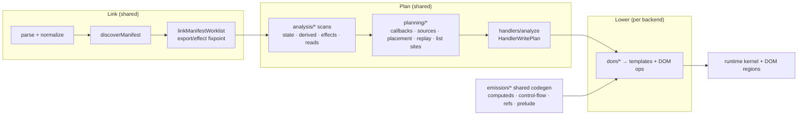
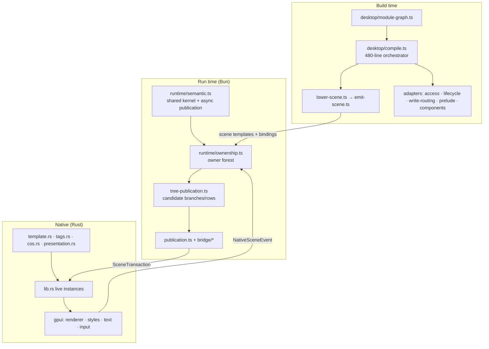

# Desktop layer analysis — `codex/desktop-renderer`

Scope: core layer (shared compiler + DOM backend + runtime kernel) → desktop layer (compiler backend, JS runtime adapter, Rust/GPUI host) → how much is reused vs. duplicated → how to present and evolve the architecture.

> [!NOTE]
> Static analysis only. I read the code and docs on this branch; I did **not** build or run the test suites, and I read the Rust/GPUI host at structure level rather than line by line. Nothing in the repo was modified.

---

## 1. TL;DR

**Verdict: the desktop layer is a genuinely shared-core design, not a fork — but its reuse is strongest at the *edges* (state, effects, refs, derivations, write facts, kernel) and weakest at the *orchestration seams* (pipeline ordering, graph linking, write publication, JSX structural planning).** Those seams are where duplication and "not implemented" gates live.

| | Finding |
| --- | --- |
| ✅ Good | Desktop compiler imports **nothing** from `compiler/src/dom/`; desktop runtime imports only `@memoized-dom/runtime/core`. Boundary is real and tested ([boundaries.test.ts](file:///C:/Users/babyface/Desktop/memoized-dom/packages/desktop/tests/boundaries.test.ts)). |
| ✅ Good | The branch already *moved* logic out of DOM into neutral `emission/` and `handlers/` (computeds, control-flow, refs, prelude, completion, execution-sites). That is the right pattern; it just stopped halfway. |
| ⚠️ Duplicated | 5 concrete duplications (§5): analysis pipeline ordering, graph crawl + alias seeding (already **diverged**), guarded write-publication skeleton, return/branch validation, JSX attribute/child handling. |
| ⚠️ Gated | 7 of the 21 `not implemented` diagnostics in the desktop compiler, plus 2 skipped analysis passes, **each already have a shared planner** that DOM uses (§6). Desktop is re-deriving a subset instead of consuming them. |
| ⚠️ Not wired | External reactivity + opaque volatility are analysed in shared code but skipped by desktop; wiring needs one small runtime capability (`visible()`), because [volatile.ts:36](file:///C:/Users/babyface/Desktop/memoized-dom/packages/runtime/src/volatile.ts#L36) reads `environment.document.hidden`, which does not exist on desktop. |
| 📚 Presentation | Architecture is documented in one 500-line mixed research/status/reference doc plus a README that overlaps it. There is no single "map" and no reuse ledger. |

**Top 5 actions (highest payoff / lowest risk first):**
1. Restructure docs into a short map + reuse ledger + gap register (zero behaviour risk) — §8.
2. Extract one `linking/project.ts` used by both `linker.ts` and desktop `module-graph.ts` (fixes a live divergence) — §5 D2.
3. Extract a neutral analysis coordinator with a *profile* (`dom` | `scene`) — §5 D1.
4. Extract shared guarded write-publication; desktop supplies only the "what to commit" callback — §5 D4.
5. Delete desktop `not implemented` gates by consuming existing shared planners, one per PR — §6.

---

## 2. The layers and their size

| Layer | Location | Lines (ts/rs) | Role |
| --- | --- | ---: | --- |
| **Shared compiler** | `compiler/src/{ast,analysis,planning,emission,handlers,linking,jsx,components,lists,context,…}` | ≈ 31.6k¹ | Backend-neutral facts: state, reads, writes, effects, structure, ownership |
| **DOM backend** | `compiler/src/dom/` | 13,458 | Templates, DOM ops, hydration, SSR writer, routing, data sites |
| **Desktop compiler backend** | `compiler/src/desktop/` | 1,896 | Scene lowering/emit + adapters over shared plans |
| **Core runtime** | `runtime/src/` | 7,181 | Kernel (entities, dirty reasons, commit), access resolver, cells, effects, refs, **plus** DOM list/cond/hydration |
| **Desktop JS adapter** | `desktop/src/` | 2,572 | Owner forest, tree preparation, publication queue, event dispatch, bridge |
| **Native host** | `desktop/rust/` | 5,916 | Tag registry, template validation, CSS cascade, presentation plans, GPUI window, text input |

¹ `compiler/src` total 45,079 − dom 13,458 − desktop 1,896.

Desktop-specific code is ~4% of compiler size on the compiler side — a good sign that reuse is the dominant mode.

### 2.1 Core layer, as it actually flows



Key observations about the core:
- **Orchestration is DOM-owned.** [dom/prepare.ts](file:///C:/Users/babyface/Desktop/memoized-dom/packages/compiler/src/dom/prepare.ts#L28-L63) + [dom/analyze.ts](file:///C:/Users/babyface/Desktop/memoized-dom/packages/compiler/src/dom/analyze.ts#L69-L155) define the *only* authoritative pass order, interleaving shared scans with DOM lowering (`lowerPrivateRowProps`, `lowerDynamicTags`, …). The architecture doc itself says "extracting a neutral analysis coordinator is a later organization change" ([docs/compiled-native-architecture.md L174](file:///C:/Users/babyface/Desktop/memoized-dom/docs/compiled-native-architecture.md)).
- **Pattern worth copying:** `analysis/external-reactivity.ts` (shared, 64 lines) + `dom/external-reactivity.ts` (DOM allocation, 51 lines). *Shared facts, backend allocation.* Desktop should follow this exactly.
- **Runtime kernel is host-neutral** ([kernel.ts](file:///C:/Users/babyface/Desktop/memoized-dom/packages/runtime/src/kernel.ts), [core.ts](file:///C:/Users/babyface/Desktop/memoized-dom/packages/runtime/src/core.ts)), with `RenderEnvironment` capabilities (`schedule`, `effects`, `refs`, `effectBoundary`). The DOM structural runtime (`list.ts`, `cond.ts`, `prepared-region.ts`, hydration, markup) is *not* neutral — it is anchored on `Node`/`Comment`/ranges.

### 2.2 Desktop layer, as built



Strengths: clean transaction/acknowledgment contract, acceptance-gated caches, effects/refs only after native acceptance (via `effectBoundary`), same-module-two-apps isolation via state cells.

---

## 3. Reuse scorecard

Legend: ✅ reused · 🟡 adapted/partially · 🔁 duplicated · ❌ missing/gated

### 3.1 Compiler

| Concern | Shared implementation | Desktop status |
| --- | --- | --- |
| Parse / normalize / frontends | `ast/*`, tsrx frontend | ✅ |
| Lexical state, derivations, effects, instance control flow | `analysis/*`, `effects/discovery` | ✅ ([compile.ts L119-139](file:///C:/Users/babyface/Desktop/memoized-dom/packages/compiler/src/desktop/compile.ts#L119-L139)) |
| Module cells / computeds / control-flow / refs / prelude emission | `cells.ts`, `emission/*` | ✅ best example of the pattern |
| Callback write facts | `handlers/analyze` → `HandlerWritePlan` | ✅ |
| Conditional branch planning | `jsx/conditional-plan` | ✅ ([regions.ts](file:///C:/Users/babyface/Desktop/memoized-dom/packages/compiler/src/desktop/regions.ts)) |
| List site/key/callback planning | `lists/*` via `analyzeMapSite` | ✅ (but delegated-callback rows gated) |
| Props shape | `components/props` | ✅ (ABI is rightly target-specific) |
| Read collection / access table | `collectReads`, `planAccessReaders` | 🟡 wrapped with a spoofed ctx ([access.ts L23-32](file:///C:/Users/babyface/Desktop/memoized-dom/packages/compiler/src/desktop/access.ts#L23-L32)) |
| Graph discovery + export fixpoint | `linking/{discovery,graph,resolution}` | 🟡 core calls reused, crawl + seeding copied (D2) |
| Analysis pass ordering | `dom/prepare.ts` + `dom/analyze.ts` | 🔁 hand-ordered subset (D1) |
| Handler publication skeleton | `dom/handler-execution.ts` + `handler-commits.ts` | 🔁 (D4) |
| Return / branch / early-return planning | `components/return-plan.ts`, `planComponentRendering` | ❌ not used; manual checks (D3) |
| JSX attributes & host children | `jsx/attributes.ts`, `jsx/children.ts` | ❌ hand-rolled in `lower-scene.ts` (D5) |
| Dynamic tags, render props, spreads, component children | `planning/dynamic-tags`, `analysis/render-props`, `jsx/attributes` | ❌ gated |
| External reactivity | `analysis/external-reactivity` | ❌ pass skipped |
| Opaque volatility | `analysis/opaque-volatility` | ❌ pass skipped |
| Data / forms / router / server functions | `packages/data`, `router`, `server` | ❌ out of scope today (undocumented as a decision) |

### 3.2 Runtime

| Concern | Core | Desktop status |
| --- | --- | --- |
| Entities, dirty reasons, ordered commit, scoped apps | `kernel.ts` | ✅ [semantic.ts](file:///C:/Users/babyface/Desktop/memoized-dom/packages/desktop/src/runtime/semantic.ts) |
| Access resolver + write routing | `access.ts`, `events.ts` | ✅ via generated code |
| State cells | `state-cells.ts` | ✅ |
| Effects, refs, cleanup, async continuations | `effect/refs/cleanup/continuation.ts` | ✅ with `effectBoundary` gating |
| Volatile pull frames | `volatile.ts` | ❌ `schedule: null` ([semantic.ts L46](file:///C:/Users/babyface/Desktop/memoized-dom/packages/desktop/src/runtime/semantic.ts#L46)) + `document.hidden` dependency |
| Keyed list reconcile | `list.ts` (LIS, `lisPositions` L88) | 🔁 parallel `Map` diff + full `order` per change ([tree-publication.ts L119-152](file:///C:/Users/babyface/Desktop/memoized-dom/packages/desktop/src/runtime/tree-publication.ts#L119-L152)) |
| Conditional regions / staged subtrees | `cond.ts`, `prepared-region.ts`, `preparation.ts` | 🔁 parallel concept (candidate child) — host-different |
| Props boxes / equality | `props.ts` | 🔁 `values.ts` (`sameProps`, `propValues`) |
| List key identity encoding | `list-keys.ts` | 🟡 not used (desktop identity is `handle.id`, which is fine) |
| Event delegation | `delegated-events.ts` | ✅ legitimately separate: events are synthesized from native payloads |

---

## 4. What is *legitimately* desktop-only (do not "share" these)

- Native event synthesis and defaults ([event-dispatch.ts](file:///C:/Users/babyface/Desktop/memoized-dom/packages/desktop/src/runtime/event-dispatch.ts), [events.ts](file:///C:/Users/babyface/Desktop/memoized-dom/packages/desktop/src/runtime/events.ts)).
- Asynchronous acceptance boundary (publication queue, acknowledgments, retry, backpressure).
- Scene schema, scene template emission, Rust tag registry/CSS cascade/GPUI.
- Props ABI (`desktopProps`) and fragment scope envelopes.

Everything else in the compiler (fact production, ordering, publication skeleton, JSX structure) should be shared.

---

## 5. Duplication register

### D1 — Analysis pipeline ordering
[desktop/compile.ts L98-146](file:///C:/Users/babyface/Desktop/memoized-dom/packages/compiler/src/desktop/compile.ts#L98-L146) hand-orders ~15 shared scans. DOM orders ~40 in `runAnalysis`/`prepareProgramAnalysis`.
- **Risk:** ordering is semantically load-bearing (comments in `analyze.ts`: volatility *must* precede derivation scanning; module computeds after helpers known). Any new shared pass must be remembered in two places; desktop silently omits `scanOpaqueVolatility`, `scanExternalReactiveImports`, `analyzeComponent`, `pathVariants` (acyclicity), `foldRenderCallbackSubtreeReads`, `normalizeConditionalJsxDirectives`, render-prop/dynamic-tag normalization.
- **Fix:** `analysis/pipeline.ts` exporting an ordered pass list; each pass tagged `shared` or backend-supplied; `runSemanticAnalysis(ctx, path, profile)`. DOM injects its lowering passes at declared hook points; desktop's profile lists omitted passes *as explicit unsupported capabilities with diagnostics* (not silence).
- **Gate:** DOM compiler output byte-identical (the repo already compares compiler output and browser artifacts); desktop suite green.

### D2 — Graph crawl and alias seeding (already diverged)
Compare [linker.ts L517-533](file:///C:/Users/babyface/Desktop/memoized-dom/packages/compiler/src/linker.ts#L517-L533) with [module-graph.ts L63-79](file:///C:/Users/babyface/Desktop/memoized-dom/packages/compiler/src/desktop/module-graph.ts#L63-L79): identical loop, except DOM guards `identity?.type !== 'component'` while desktop accepts *any* identity (state, function, value). One of them is likely wrong for the other's use case, and nobody will notice until a barrel re-exports state differently across targets. The `visit` crawl in desktop also reimplements what the Vite collector does through the bundler.
- **Fix:** `linking/project.ts`: `seedReexportIdentities(entries, discovered, options, accept)` + `linkProject(entries, options, rootId)` returning `{ entries, manifests }`. Parameterize the accept predicate only if the divergence is intentional (document why).
- Also fold [desktop/imports.ts](file:///C:/Users/babyface/Desktop/memoized-dom/packages/compiler/src/desktop/imports.ts) (single-file fallback, 75 lines) into `linking/discovery` so there is one implementation of "what does this import resolve to".

### D3 — Return / branch planning not consumed
[compile.ts L198-225](file:///C:/Users/babyface/Desktop/memoized-dom/packages/compiler/src/desktop/compile.ts#L198-L225) manually checks for a final JSX return and rejects early returns, dynamic roots and nested factories. `components/return-plan.ts` (`analyzeComponentReturns`, 360 lines) + `planning/component-render.ts` already model direct / if-else / switch returns and are validated "before any factory is replaced".
- **Fix:** consume `ModuleRenderPlan`; desktop lowers `ComponentReturnPlan` branches to scene regions (it already lowers conditionals to regions, so this is the same primitive).

### D4 — Guarded write publication skeleton
[desktop/write-routing.ts L14-114](file:///C:/Users/babyface/Desktop/memoized-dom/packages/compiler/src/desktop/write-routing.ts#L14-L114) vs [dom/handler-execution.ts L15-151](file:///C:/Users/babyface/Desktop/memoized-dom/packages/compiler/src/dom/handler-execution.ts#L15-L151) + [handler-commits.ts L20-154](file:///C:/Users/babyface/Desktop/memoized-dom/packages/compiler/src/dom/handler-commits.ts#L20-L154). Both: build per-site commit → allocate flags → `markExecutionSite` sorted by path depth → wrap guarded commits → `appendScopeCommit` → hoist `let` declarations → rebind body. Only the *commit statement* differs (`commitWrites`/`markDirtySubtree` + `notify(local)` vs DOM reasons/row refresh/`commitStructuralWrites`).
- Additional drift: DOM merges adjacent identical refresh commits (avoids double render under sync scheduler); desktop does not. DOM distinguishes structural vs ordinary writes; desktop sends everything through `commitWrites`.
- **Fix:** `handlers/publication.ts`: `emitGuardedPublication(plan, { commitFor(scope): Statement | null, continuations?: Identifier })`. DOM and desktop each pass their `commitFor`. Async-continuation instrumentation ([handlers/continuations.ts](file:///C:/Users/babyface/Desktop/memoized-dom/packages/compiler/src/handlers/continuations.ts)) is currently consumed **only** by desktop — decide whether DOM should adopt await-boundary publication (behaviour change → separate decision) or keep it behind a flag.

### D5 — JSX attributes and host children
[lower-scene.ts L285-403](file:///C:/Users/babyface/Desktop/memoized-dom/packages/compiler/src/desktop/lower-scene.ts#L285-L403) hand-rolls attribute loop (alias `className`, duplicate detection, allowlist, event name map, ref handling, style literal parsing). Shared `jsx/attributes.ts` (`planOrderedAttributes`: spread-aware ordering, safe event keys) and `jsx/children.ts` (`planDirectChildren`) exist.
- **Fix:** lower from `OrderedAttributePlan`; keep desktop's *capability table* (below) as the only desktop-specific decision.

### D6 (minor) — Misc.
- `access.ts` builds a spoof ctx (`{...ctx, listedSites: new Map(), …}`) to coerce `planAccessReaders`. Replace with an explicit `AccessPlanOptions { collapseRegionReads: true }` so the intent is typed, not implied.
- `valueExpression` lives in `lower-scene.ts` but is imported by `prelude.ts`, `lifecycle.ts`, `write-routing.ts`, `compile.ts` — a utility pretending to be part of a lowering file. Move to `desktop/value.ts`.
- Repo hygiene: untracked `nul` file at repo root (Windows redirect artifact) and an uncommitted edit to `packages/desktop/examples/counter/App.tsx`.

---

## 6. "Not implemented" gates that already have a shared planner

| Desktop gate | Location | Shared planner to consume |
| --- | --- | --- |
| early component returns / dynamic roots | compile.ts L213-216 | `components/return-plan.ts`, `planComponentRendering` |
| dynamic tags | lower-scene L262, component-call L21 | `planning/dynamic-tags.ts` |
| render-prop callbacks / component children | component-call L34, L60 | `analysis/render-props.ts`, `components/render-functions.ts`, `jsx/children.ts` |
| spread / namespaced attributes | lower-scene L287 | `jsx/attributes.ts` |
| delegated row callbacks | lists.ts L35 | `lists/callback-plan.ts` |
| row-callback preludes with statements | lists.ts L41 | `emission/prelude.ts` replay |
| nullish branch choice | regions.ts L18 | `jsx/conditional-plan.ts` (already handles `??` shape for DOM) |
| external reactive values | README §Third-party | `analysis/external-reactivity.ts` |
| opaque volatile values | README §Third-party | `analysis/opaque-volatility.ts` + `runtime/volatile.ts` |

The remaining gates (CSS selectors/at-rules, grid tracks, non-text inputs, per-span font size, etc.) are *native-host* limits and belong in the capability reference, not the compiler.

---

## 7. Runtime findings

- **R1 — Volatile/external wiring needs a capability, not a fork.** `volatile.ts` uses `environment.schedule` ✔ but also `environment.document.hidden` ✘. On desktop `document` resolves to `ambientDocument()` and throws. Add `RenderEnvironment.visible?: () => boolean` (default derived from `document.hidden` for browsers); desktop supplies "window visible" and `schedule` = native frame callback. Then compiler output of `registerEntity({ volatile: true })` for scene owners works with zero new subsystem. README already identifies this as the intended path.
- **R2 — Structural planning is DOM-coupled in core, so desktop re-implemented it.** The *host-neutral* part of `list.ts` is the LIS move planner and keyed diff. Extract `planKeyedReconcile(oldKeys, newKeys) → { removed, created, order, moves }` and let DOM apply it to nodes and desktop to `SceneOperation`s. Today desktop emits a full `order` list for every changed list, i.e. O(rows) per change, and cannot express a minimal move. **Gate:** `list.ts` is benchmark-tuned (see `compiler-architecture.md` cyclic-reuse notes); extraction must pass `bench:dom:compare` and Octane smoke before merge. Optional, last.
- **R3 — Two implementations of "candidate subtree before commit".** `prepared-region.ts` (DOM, anchors + `DocumentFragment`) and `tree-publication.ts` (desktop, candidate child + `PreparedPublication`). Different hosts, same invariants (rejection retains old tree, staged owners released). Not worth merging code; **do** share a contract test-suite (same scenario table run against both) so semantics cannot drift.
- **R4 — `props.ts` vs `values.ts`.** Equality/shape rules differ slightly (desktop restricts to primitives + owned callbacks). Keep, but document as intentional and keep the error text aligned.

---

## 8. Presenting the architecture: a clearer path

### 8.1 Problems with the current presentation
1. [docs/compiled-native-architecture.md](file:///C:/Users/babyface/Desktop/memoized-dom/docs/compiled-native-architecture.md) (~500 lines, 80 KB) mixes **pitch**, **GPUIX comparison**, **status**, **reuse table**, **package boundaries**, **tag table** (duplicated in the README), **GPUI phase notes**, **styling research**, **protocol**, **invalidation theory**. A reader cannot tell what is *implemented* vs *proposed*.
2. [packages/desktop/README.md](file:///C:/Users/babyface/Desktop/memoized-dom/packages/desktop/README.md) is a good capability reference but also carries architecture and a third-party-library roadmap.
3. No diagram of *who calls whom*; no reuse ledger; gaps are scattered as prose.
4. `compile.ts` (480 lines) is the de-facto architecture doc for the compiler, and it interleaves pipeline, per-component lowering and module finalization.

### 8.2 One mental model (use it everywhere)

```text
 LINK      one source graph, canonical identities          (shared)
 PLAN      shared semantic facts & plans                    (shared)
 LOWER     destination lowering: dom  |  scene              (backend)
 KERNEL    shared reactive kernel: entities→dirty→commit    (shared)
 ADAPT     destination adapter: DOM regions | owner forest  (backend)
 HOST      browser DOM  |  Rust scene + GPUI                (platform)
```

Every file, doc section, and PR description names which of the six stages it touches. "Desktop-only" is only legitimate in LOWER, ADAPT, HOST.

### 8.3 Proposed docs layout (no behaviour change; can start immediately)

```text
docs/desktop/
  README.md            one page: diagram above, stage table, "where do I look"
  01-pipeline.md       LINK→PLAN→LOWER on desktop; which shared passes run, which are gated
  02-runtime.md        KERNEL+ADAPT: owner forest, preparation vs acceptance, effect gating
  03-native-host.md    HOST: scene protocol, tag registry, CSS cascade, GPUI phases
  04-reuse-ledger.md   §3 tables, kept current; each row links to code (single source of truth)
  05-gaps-roadmap.md   §6 gates + phases; each gap names the shared planner to consume
  research/            GPUIX comparison, GPUI/Taffy notes (moved verbatim)
packages/desktop/README.md   stays the capability contract (tags/attrs/events/CSS/lifecycle)
docs/compiled-native-architecture.md → short pointer/redirect after migration
```

Rule: **capability facts live only in the package README**; architecture docs link to it instead of restating tag/CSS tables.

### 8.4 Proposed code layout (rename/extract only; do last to limit churn)

```text
compiler/src/
  linking/project.ts            NEW shared (D2)
  analysis/pipeline.ts          NEW shared coordinator + profiles (D1)
  handlers/publication.ts       NEW shared guarded publication (D4)
  dom/…                         unchanged API, consumes the three above
  desktop/
    index.ts
    pipeline.ts                 profile + orchestration (from compile.ts L98-196)
    component.ts                per-component lowering (compile.ts L198-346)
    module.ts                   module finalization (compile.ts L348-479)
    graph.ts                    thin wrapper over linking/project
    scene/   lower.ts emit.ts attributes.ts events.ts css.ts regions.ts lists.ts component-call.ts
    adapters/ access.ts lifecycle.ts write-routing.ts prelude.ts props.ts external-reactivity.ts(new)
    capabilities.ts             NEW single table: attrs, events, diagnostics
desktop/src/
  kernel/   semantic.ts publication.ts
  owners/   ownership*.ts tree-publication.ts lifecycle.ts regions.ts lists.ts values.ts
  events/   event-dispatch.ts events.ts
  bridge/ scene/ dev/           unchanged
```

`capabilities.ts` open question: the Rust `tags.rs` registry is authoritative (docs say so). Best long-term: emit a `capabilities.json` from the Rust crate at build and have the compiler read it, so unsupported tags fail at **compile** time with source locations instead of at native install time. Until then, keep the TS table minimal and generated-or-tested against Rust.

### 8.5 Enforced boundaries (add tests, they are cheap)
- `compiler/src/desktop/**` must not import `compiler/src/dom/**` (true today — lock it in).
- `analysis|planning|emission|handlers|linking|jsx|components|lists` must not import `desktop/**` or `dom/**` (an equivalent DOM test exists; extend to desktop).
- `desktop/src/**` may import `@memoized-dom/runtime/core` and `/node-context` only (true today).
- New: a **reuse-ledger test** that fails if a ledger row marks a shared planner as "consumed" but the import disappears (optional; keeps the doc honest).

---

## 9. Roadmap with gates

| Phase | Work | Risk | Gate |
| --- | --- | --- | --- |
| 0 | Docs restructure (§8.3); delete `nul`; resolve `counter/App.tsx` edit; add boundary tests | none | docs review; `test:desktop` |
| 1 | `linking/project.ts` (D2) incl. decision on component-only vs any-identity seeding | low | DOM linker tests + desktop reactivity tests; add a barrel re-export-of-state test for both targets |
| 2 | `analysis/pipeline.ts` with profiles (D1) | medium | DOM compiler output **byte-identical**; desktop suite |
| 3 | `handlers/publication.ts` (D4) + `planComponentRendering` in desktop (D3) | medium | DOM output identical; desktop async/rejection tests (`runtime-parity`) |
| 4 | Close §6 gates one-by-one via shared planners (returns → spreads → children/render-props → dynamic tags → row callbacks) | low each | each PR deletes a `fail('…not implemented')` and adds a desktop test + a shared-planner contract test |
| 5 | External reactivity + volatility: `desktop/adapters/external-reactivity.ts`, `RenderEnvironment.visible`, native frame scheduler | medium | headless fixture with a subscribable store; library-owned async change refreshes a destination; disposal via `cleanup` |
| 6 | Optional: `planKeyedReconcile` extraction (R2) | high (perf) | `bench:dom:compare`, Octane smoke, no regression; desktop emits moves |
| 7 | Code layout rename (§8.4) | low (churn) | pure move; tests unchanged |

> [!IMPORTANT]
> Phases 2–3 touch DOM output paths. The repo's own practice (identical compiler output + identical browser artifacts, ABBA timing) is the right gate; do not merge them on desktop tests alone.

---

## 10. Risks and unverified items
- I did not execute `bun run test` / `test:desktop` / cargo tests; claims about behaviour are from reading code and docs.
- Whether the D2 divergence (`component`-only vs any identity) is intentional is unknown; it needs the author's call.
- Whether DOM should adopt await-boundary publication (`handlers/continuations.ts`) is a product/behaviour decision, not a refactor.
- Data/forms/router/server-functions on desktop are absent and unscoped; I treated them as out of scope until you decide otherwise.
- Rust/GPUI internals were assessed from file structure, README and architecture docs only.

## 11. Decisions needed from you
1. **Start with docs (Phase 0) or compiler seams (Phases 1–3)?** I recommend docs first, then D2 → D1 → D4.
2. **D2 divergence:** should barrel re-exports of state/functions be seeded for DOM too, or is component-only intentional?
3. **Scope of "reuse everything":** include `@memoized-dom/data` / router / server functions on desktop, or defer them behind an explicit non-goal?
4. **Capabilities source of truth:** generate a compile-time capability table from Rust `tags.rs`, or keep a hand-maintained TS table with a parity test?
